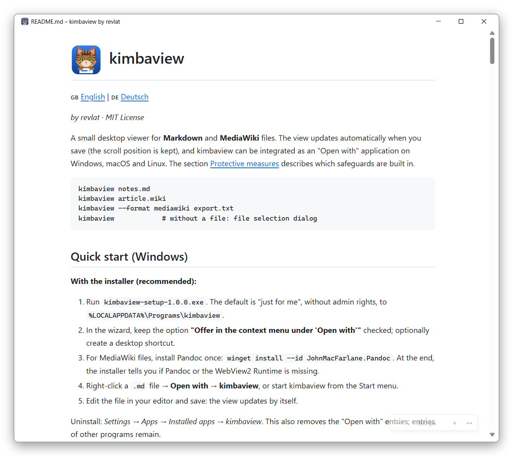

#  kimbaview

🇬🇧 [English](README.md) | 🇩🇪 [Deutsch](README_DE.md)

*by revlat · MIT License*

A small desktop viewer for **Markdown** and **MediaWiki** files.
The view updates automatically when you save (the scroll position is kept), and
kimbaview can be integrated as an "Open with" application on Windows, macOS and
Linux. The section [Protective measures](#protective-measures) describes which
safeguards are built in.

```
kimbaview notes.md
kimbaview article.wiki
kimbaview --format mediawiki export.txt
kimbaview            # without a file: file selection dialog
```

## Screenshot

*This is what kimbaview looks like, here showing this guide:*



## Quick start (Windows)

**With the installer (recommended):**

1. Run `kimbaview-setup-1.0.0.exe`. The default is "just for me", without admin
   rights, to `%LOCALAPPDATA%\Programs\kimbaview`.
2. In the wizard, keep the option **"Offer in the context menu under 'Open with'"**
   checked; optionally create a desktop shortcut.
3. For MediaWiki files, install Pandoc once:
   `winget install --id JohnMacFarlane.Pandoc`. At the end, the installer tells you if
   Pandoc or the WebView2 Runtime is missing.
4. Right-click a `.md` file → **Open with → kimbaview**, or start kimbaview from the
   Start menu.
5. Edit the file in your editor and save: the view updates by itself.

Uninstall: *Settings → Apps → Installed apps → kimbaview*. This also removes the
"Open with" entries; entries of other programs remain.

**Without installer (portable):** copy the whole `kimbaview` folder (with
`kimbaview.exe`, `_internal` and the license files) to a permanent location and start
`kimbaview.exe`, or drop a file onto it. Set up "Open with" with a script, see
[Setting up "Open with"](#setting-up-open-with).

Requirements on the target computer: Windows 10/11 (64-bit), WebView2 Runtime
(included in Windows 11), .NET Framework 4.7.2+ (included in Windows 10/11). Python is
**not** required.

On first start, Windows SmartScreen may warn you because the installer and program are
not signed (*More info → Run anyway*).

## Quick start (macOS)

1. Download `kimbaview-<version>-macos-arm64.dmg` from the GitHub releases and open it.
2. Drag `kimbaview` to the **Applications** folder.
3. For MediaWiki files: `brew install pandoc` (Markdown works without it).
4. Right-click a `.md` file in Finder → **Open With → kimbaview**.

If the build is not signed, macOS reports on first start that the app cannot be
opened. Then open *System Settings → Privacy & Security*, scroll down and click
**"Open Anyway"** next to kimbaview (once). Packages are currently built only for Macs
with Apple silicon (M1 and newer).

## Quick start (Linux)

Requirements: Python 3.10+ and the system's web engine, e.g. from Ubuntu 22.04,
Debian 12, Fedora 36, Linux Mint 21.

```bash
# 1. System packages (once; Fedora/Arch/openSUSE: see the message from install.sh)
sudo apt install python3-venv python3-gi gir1.2-webkit2-4.1 pandoc

# 2. Extract the package from the GitHub releases and install it (no root rights)
tar xzf kimbaview-<version>-linux.tar.gz
cd kimbaview-<version>-linux
./install.sh
```

Afterwards kimbaview is in the application menu and under **Open with**; in a terminal
use `kimbaview file.md`. Remove it with `./uninstall.sh` in the same folder.
`install.sh` checks all requirements first and, if needed, shows the matching install
command for Debian/Ubuntu, Fedora, Arch and openSUSE.

A GitHub pipeline (`.github/workflows/build.yml`) builds the packages for all three
systems.

---

## Installing from source (development)

### 1. Python 3.10 or newer

| System  | Command / source |
|---------|------------------|
| Windows | `winget install Python.Python.3.12` or https://www.python.org |
| macOS   | `brew install python@3.12` or https://www.python.org |
| Linux   | usually present; otherwise `sudo apt install python3 python3-venv` |

### 2. Pandoc (MediaWiki only)

Markdown works without Pandoc. If Pandoc is missing, kimbaview shows a message with
installation instructions for MediaWiki files.

| System  | Command |
|---------|---------|
| Windows | `winget install --id JohnMacFarlane.Pandoc` |
| macOS   | `brew install pandoc` |
| Linux   | `sudo apt install pandoc` · `sudo dnf install pandoc` · `sudo pacman -S pandoc` |

kimbaview looks for Pandoc in `PATH` and also in the usual locations
(`%LOCALAPPDATA%\Pandoc`, `C:\Program Files\Pandoc`, `/opt/homebrew/bin`, `/usr/local/bin`,
`/usr/bin`, `~/.local/bin`). This is necessary because programs started by double-click
often have a shortened `PATH`.
Pandoc **2.15 or newer** is recommended, because kimbaview then uses `--sandbox`.

### 3. kimbaview

```bash
git clone … kimbaview && cd kimbaview      # or extract the folder
python -m venv .venv
# Windows:  .venv\Scripts\activate      macOS/Linux:  source .venv/bin/activate
pip install -e .
pip install -e ".[dev]"                  # additionally pytest for the tests
```

This provides the `kimbaview` command. On Windows it is a GUI program
(`.venv\Scripts\kimbaview.exe`) and does **not** open a console window.

**Linux:** pywebview uses the system's web engine (WebKitGTK). Its Python binding
(`gi`) is most reliable from the system packages, so create the venv with
`--system-site-packages`:

```bash
sudo apt install python3-venv python3-gi gir1.2-webkit2-4.1
python3 -m venv --system-site-packages .venv && . .venv/bin/activate
pip install -e ".[dev]"
```

(`pip install "pywebview[gtk]"` would compile PyGObject from source and often fails
without development packages. Qt is an alternative: `pip install -e ".[qt]"`.)

**Windows:** requires the Microsoft Edge WebView2 Runtime. It is preinstalled on
Windows 11.

---

## Usage

* `kimbaview <file>` opens the file in its own window. Several files
  (`kimbaview a.md b.wiki`) each get their own window with their own file watching.
  With "Open with", a separate process starts for each file anyway.
* Without a file, a file selection dialog appears; *Cancel* closes the window.
* **Format detection** by extension:
  Markdown: `.md`, `.markdown`; MediaWiki: `.mediawiki`, `.wiki`, `.wikitext`.
  `--format md|mediawiki` overrides the detection.
* The window title shows the file name.
* **Live updates:** saving triggers a re-render (debounced, about 200 ms); the scroll
  position is kept. If the file is deleted or renamed, a notice appears and the last
  version stays visible. When it reappears, it is reloaded.
* **Errors** (e.g. half-finished syntax, Pandoc errors, file too large) appear as a
  notice bar at the top. The last working version stays visible.
* **Links**
  * `http(s)` opens in the default browser. The target address is shown in the tooltip.
  * `#section` jumps within the document.
  * **Links to other Markdown/MediaWiki files** (`chapter2.md`, `subfolder/page.md`,
    `../index.md`, `other.md#section`) open the file **in the same window**.
    **Ctrl+click** or **middle-click** opens it in a **new window**.
  * **Back/forward:** the arrows `‹ ›` at the bottom right, **Alt+← / Alt+→** or the
    side buttons of the mouse. Each page keeps its scroll position.
  * MediaWiki links without an extension (`[[Page]]`) look for `Page.wiki`,
    `Page.mediawiki` etc. in the same folder (underscores are also tried as spaces).
  * **Boundary:** only files in the folder of the first opened file and its subfolders
    can be reached. Within it, links upwards (`../`) work too. Targets outside, missing
    files and other file types (`.pdf`, `.exe`, images …) are not opened; a short
    notice appears at the bottom left.
  * `mailto:`, `file:` and other schemes are ignored.
* **Text width:** the small bar at the bottom right (it becomes clearly visible on
  hover) sets the width in steps: 600, 700, 800, 900, 1000, 1200, 1400 px or full
  window width. Shortcuts: **Ctrl+Shift+←/→** narrower/wider, **Ctrl+Shift+F** full
  width on/off. The last chosen width is used again on the next start. It is stored in
  `%APPDATA%\kimbaview\settings.json` (macOS: `~/Library/Application Support/kimbaview/`,
  Linux: `~/.config/kimbaview/`).
* **Language:** the interface is in German if the system language is German, otherwise
  in English. Switch with `--lang en` or `--lang de`, or the environment variable
  `KIMBAVIEW_LANG`. The installer also chooses its language based on the Windows
  language.
* Ctrl + mouse wheel / Ctrl + `+`/`-` zooms.
* `--debug` writes log messages to stderr (only visible when started from a terminal
  with `python -m kimbaview --debug …`).

### Example files

| File | Content |
|------|---------|
| `examples/example.md` | headings, lists, task list, table with alignment, code, local image, footnote, links to other files |
| `examples/unterordner/seite.md` | links back (`../example.md`, with anchor), to MediaWiki and to a missing target; image from the parent folder |
| `examples/example.mediawiki` | the same in MediaWiki including templates (`{{Infobox Software}}`, `{{Datum}}`) |
| `examples/evil.md` | typical attacks (scripts, event handlers, `javascript:` links, external images, paths outside, forms, DOM clobbering). Used to test the protective measures; the attacks should be displayed defused. |

The example files are in German.

---

## Setting up "Open with"

### Windows (fully implemented and tested)

**Build the installer** (recommended for distribution). Requires Inno Setup 6:
`winget install JRSoftware.InnoSetup`.

```powershell
pip install -e ".[build]"
powershell -ExecutionPolicy Bypass -File packaging\windows\build-installer.ps1
```

Result: `dist\installer\kimbaview-setup-<version>.exe`. It contains the program,
licenses, Start menu entry, the optional "Open with" registration (the same entries as
the script below) and an uninstaller. The configuration is in
`packaging\windows\kimbaview.iss`.

**Alternatively without installer:**

1. **Build the program** (PyInstaller, folder build without console window):

   ```powershell
   pip install -e ".[build]"
   powershell -ExecutionPolicy Bypass -File packaging\windows\build.ps1
   ```

   Result: `dist\kimbaview\kimbaview.exe` (keep the whole `dist\kimbaview` folder).
   Preferably copy it to a permanent location, e.g. `%LOCALAPPDATA%\Programs\kimbaview`.

2. **Register** (current user only, **no admin rights**):

   ```powershell
   powershell -ExecutionPolicy Bypass -File packaging\windows\register-openwith.ps1
   # different location of the exe:
   powershell -ExecutionPolicy Bypass -File packaging\windows\register-openwith.ps1 -ExePath "C:\…\kimbaview.exe"
   # only show what would happen:
   powershell -ExecutionPolicy Bypass -File packaging\windows\register-openwith.ps1 -WhatIf
   ```

   Afterwards kimbaview appears for `.md`, `.markdown`, `.mediawiki` and `.wiki` in the
   context menu under **Open with**. The default program is not changed. To make
   kimbaview the default: *Open with → Choose another app → kimbaview → Always*.

   The pip installation works too, without a PyInstaller build:
   `-ExePath .venv\Scripts\kimbaview.exe`.

3. **Remove:**

   ```powershell
   powershell -ExecutionPolicy Bypass -File packaging\windows\unregister-openwith.ps1
   ```

   The script only removes kimbaview's entries (`HKCU\Software\Classes\kimbaview.Document`,
   `…\Applications\kimbaview.exe` and the value `kimbaview.Document` under
   `…\.<extension>\OpenWithProgids`). Entries of other programs remain untouched.

### macOS (py2app)

The GitHub pipeline builds ready-made DMG packages. To build it yourself on a Mac in
the project folder:

```bash
python3 -m venv .venv && source .venv/bin/activate
pip install . py2app                 # without -e: py2app handles editable installs poorly
sh packaging/macos/build-dmg.sh      # → dist/kimbaview.app and dist/kimbaview-<v>-macos-<arch>.dmg
cp -R dist/kimbaview.app ~/Applications/        # or open the DMG and drag it in
```

The `Info.plist` registers the file types (`CFBundleDocumentTypes` for
`net.daringfireball.markdown` and `org.mediawiki.wikitext` with the extensions
`md, markdown, mediawiki, wiki, wikitext`, role *Viewer*, rank *Alternate*). kimbaview
then appears in Finder under **Open With**. If not right away: start the app once, or
log out and back in.

Notes:
* Without a Developer ID signature, macOS blocks the first start. Allow it under
  *System Settings → Privacy & Security → "Open Anyway"*. The pipeline signs and
  notarizes automatically once the matching secrets are stored in the repository.
* macOS passes files via Apple events. py2app converts them to `sys.argv` at
  **startup** (`argv_emulation`). If kimbaview is already running, another "Open With"
  does not start a second instance. In that case close kimbaview and open again, or use
  `open -n -a kimbaview file.md`.
* Pandoc from Homebrew is found even without `PATH` (`/opt/homebrew/bin`, `/usr/local/bin`).

### Linux (.desktop file)

With the ready-made package, `./install.sh` does everything (see quick start). For an
installation from source:

```bash
# create the venv as described above under "Installing from source", then:
sh packaging/linux/install.sh      # register (current user)
sh packaging/linux/uninstall.sh    # remove
```

`install.sh` copies `kimbaview.desktop` (`Exec=kimbaview %f`) to
`~/.local/share/applications` and the custom MIME type **`text/x-mediawiki`**
(`*.mediawiki`, `*.wiki`, `*.wikitext`) to `~/.local/share/mime/packages`. Then it runs
`update-mime-database` and `update-desktop-database`. Markdown uses the standard type
`text/markdown`.
If `kimbaview` is found in `PATH`, the script writes the absolute path into `Exec=`,
because application menus often do not know `~/.local/bin` or a venv.
To set it as default (optional):
`xdg-mime default kimbaview.desktop text/markdown text/x-mediawiki`.

---

## Protective measures

This section describes which precautions kimbaview takes when displaying files.
It is **not a guarantee**: software can contain bugs, and there is no warranty (see
[License and liability](#license-and-liability)). Open files from unknown sources with
the same caution as with other programs.

| Layer | Measure |
|-------|---------|
| **Sanitizing** | The HTML of **both** formats passes through **nh3** (ammonia) with an allowlist: formatting, headings, lists, tables, code, images, links. `script`, `style`, `iframe`, `object`, `embed`, `svg`, `math`, `template` etc. are removed **including their content**; `form`, `input` (except task checkboxes), `link`, `meta`, `base` are dropped. No `on*` attributes. `href`/`src` only `http`/`https` or relative; `javascript:`, `data:`, `file:`, `vbscript:`, protocol-relative `//host` URLs and obfuscated schemes (`jav%09ascript:`) are removed. CSS classes only from a fixed list. `style` only `text-align` in table cells, which is converted into a class. |
| **DOM clobbering** | All `id`s from documents get the prefix `wv-u-`; `name` is not allowed. Documents therefore cannot shadow elements or globals of the interface. |
| **Content Security Policy** | `default-src 'none'`; script and styles **only via nonce** (one own script, one own stylesheet); `img-src data:`; `connect-src`, `font-src`, `frame-src`, `object-src`, `form-action`, `base-uri` = `'none'`. No `unsafe-inline`, no `unsafe-eval`. Checked in the real WebView: inline scripts injected afterwards and external images are blocked. |
| **No external resources** | CSS and script are local in the package. Fonts are system fonts (nothing is downloaded). Syntax highlighting is done by **Pygments in Python**, i.e. without a JavaScript library in the window. External images are **not** loaded but shown as a placeholder with their address. |
| **Local document links** | Only files with a document extension (`.md`, `.markdown`, `.mediawiki`, `.wiki`, `.wikitext`), never programs or other file types. After full resolution (including symlinks/junctions), the target must be inside the *root folder*, i.e. the folder of the file you opened yourself (command line, "Open with", dialog). Opened files are sanitized like any other. The request arrives as a data value via `pywebview.state` and is checked in Python for type, length and allowed values. |
| **Local images** | Only from the root folder (folder of the first opened file) and its subfolders; relative paths start from the document currently shown. The path is fully resolved (`..`, URL encoding, symlinks, Windows junctions). Rejected: everything outside, absolute paths, drive letters, UNC paths and NTFS streams (`a.png:x`). Allowed images are embedded as `data:` URIs (max. 10 MB per image, 40 MB per document; image extensions only). The window itself has no file access (`ALLOW_FILE_URLS = False`). |
| **Links** | Never in the reader window. A dedicated script intercepts clicks (including middle-click): `#anchor` scrolls, `http(s)` goes to pywebview's "new window" → default browser, everything else is discarded. In addition, `webbrowser.open` is replaced process-wide in Python by a check that only lets `http`/`https` with a host name through, as a second check independent of the script. Dragging and dropping files into the window is blocked (it would otherwise navigate unchecked). |
| **No JS API bridge** | `js_api` is **not** used. JavaScript cannot call any Python function. Python pushes content into the window only via `run_js` as a JSON literal. The window only reports back data values via pywebview's `state` object: the chosen text width (only values from the fixed list of width steps) and navigation requests (open/back/forward, see above). Both are checked strictly in Python. |
| **No server, no port** | The page is loaded directly (`html=`), content via `run_js`. No network port is opened. |
| **Pandoc** | Only `subprocess.run([...], shell=False)`, input via stdin, output via stdout, **time limit 10 s**. Arguments: `--sandbox --from=mediawiki --to=html5 --wrap=none --syntax-highlighting=none`. No filters, no Lua, no `--standalone`, no templates, no fetching of resources. No console window on Windows. |
| **Files** | Files over **20 MB** are rejected with a notice (checked before *and* while reading). Invalid UTF-8 is read with replacement characters. Errors while reading and rendering are shown as a notice instead of terminating the program. |
| **Privacy** | No telemetry, no update check, no network access. The only exception: clicking an http(s) link opens the default browser. The WebView runs in private mode (no cookies/cache on disk). |

### Remaining risks

* **The system's web engine:** protection also depends on WebView2, WKWebView or
  WebKitGTK. Keep them up to date (Windows Update, macOS updates, package manager).
* **pywebview internals:** pywebview injects its own JavaScript with an internal
  messaging interface, even without `js_api`. It would only be reachable if the
  sanitizer **and** the CSP failed at the same time.
* **TOCTOU for images:** between path check and reading, an attacker with write access
  to the document folder could swap a symlink. Anyone who can write there could,
  however, change the file itself anyway.
* **Pandoc without `--sandbox`:** with Pandoc < 2.15 the additional sandbox is missing.
  The MediaWiki reader does not fetch files even then, but updating is recommended.
* **Computing time:** very large, pathological documents can slow down rendering. This
  is limited by the 20 MB limit, the Pandoc time limit and no highlighting for code
  blocks over 200,000 characters.
* **External links:** a click opens the real address in the browser. kimbaview does not
  detect phishing links. The target address appears as a tooltip when you hover over
  the link. It is worth a look before clicking.
* **Unsigned builds:** `.exe`/`.app` are not signed. SmartScreen or Gatekeeper warn on
  first start.

---

## Design decisions

* **Python + pywebview** instead of Go/Wails: mature libraries exist for all
  requirements (markdown-it-py, nh3, watchdog, Pygments, PyInstaller, py2app). pywebview
  uses the built-in web engine on all three systems.
* **Content via `run_js`, images as `data:` URIs:** the window therefore needs neither
  a local server nor file access.
* **No JS bridge:** external links use pywebview's built-in "new window → browser"
  handling plus `webbrowser.open` checked on the Python side.
* **Pygments instead of highlight.js:** highlighting happens in Python before
  sanitizing, so no additional script runs in the window. Pandoc's own highlighting is
  switched off so that both formats look the same.
* **Raw HTML in Markdown is allowed** (e.g. `<details>`, `<kbd>`, `<sup>`), but always
  sanitized. `<script>` is removed including its content.
* **Templates in MediaWiki:** Pandoc silently drops `{{…}}`. kimbaview replaces
  templates with markers beforehand and afterwards shows a placeholder `{{Name}}` with a
  dashed border. Nested templates count as one. In `<nowiki>`, `<pre>`,
  `<syntaxhighlight>`, `<source>`, `<math>` and comments, `{{…}}` stays unchanged (as in
  MediaWiki). MediaWiki evaluates templates inside `<code>`, so a placeholder appears
  there too.
* **Unknown extension** (e.g. `.txt` via "Open with"): displayed as Markdown.
* **Root folder for links and images:** the boundary is the folder of the file you
  explicitly opened, not the folder of the file currently shown. This way links into
  subfolders *and* back (`../index.md`) work without a document gaining access to
  folders above. To browse a whole documentation, open the top-level file (e.g.
  `index.md`).
* **Internal wiki links** (`[[Page]]`) point to a file with the same name in the same
  folder, if present. There is no actual wiki, after all.
* **Watchdog timeout 0.1 s:** by default watchdog bundles events for one second. With
  the shorter timeout, a saved change appears after about 0.3–0.4 s instead of 1.2 s.
* **`.wikitext`** is detected but not registered by the Windows scripts (requirement:
  `.md`, `.markdown`, `.mediawiki`, `.wiki`). Add it to `$extensions` if needed.
* **PyInstaller as a folder build** (`--onedir`): starts faster than `--onefile` and
  triggers fewer antivirus false positives.
* **The directory is watched**, not the file (atomic saving). If the opened file is a
  symlink, changes to the link name are detected, not to a target in another folder.
* **Languages:** English is the default and fallback language; German is used when the
  system language is German. The texts are in `src/kimbaview/i18n.py`.

---

## Tests

```bash
pip install -e ".[dev]"
pytest
```

All tests run **without a graphical display**:

* `test_formats.py`: detection by extension and `--format`
* `test_render.py`: both formats (headings, lists, tables, code, links, footnotes,
  task lists, template placeholders, local images)
* `test_security.py`: `<script>`, event handlers, `javascript:`/`data:`/`file:` links,
  dangerous tags, path traversal, symlinks/junctions pointing outside, file size,
  invalid UTF-8, Pandoc call (no shell, minimal arguments, time limit, missing
  Pandoc), CSP, `webbrowser` safeguard, `evil.md`
* `test_watcher.py`: change, atomic save, delete/restore, rename, debouncing,
  independent watchers, end-to-end with controller
* `test_controller.py`: error behavior (last version stays, never crash)
* `test_navigation.py`: links between documents (subfolders, `../`, anchors, wiki
  links without extension), rejection of targets outside, symlinks/junctions, absolute
  paths, other file types; checking of requests from the window
* `test_settings.py`: stored text width, broken/manipulated settings file
* `test_i18n.py`: all texts present in both languages, language selection, English as
  default

Tests that need a real Pandoc are skipped without Pandoc. The test for file symlinks
is skipped on Windows without developer mode; directory links pointing outside are
tested there via junctions.

## License and liability

kimbaview is licensed under the **MIT License** (see [`LICENSE`](LICENSE)). The license
allows use, modification and distribution, including commercially, as long as the
license text is included. It excludes warranty and liability: the software is provided
"as is", without warranty of any kind, and the authors or copyright holders are not
liable for any claim, damages or other liability arising from the software or its use.

**Third-party components:** the built programs contain Python and several libraries
under permissive licenses: pywebview, Pygments, pycparser (BSD); markdown-it-py,
mdit-py-plugins, mdurl, nh3, pythonnet, clr-loader, bottle, proxy-tools, cffi (MIT or
MIT-0); watchdog (Apache-2.0); Python, typing-extensions (PSF). The build scripts
automatically create `THIRD-PARTY-LICENSES.txt` with all license texts and place it,
together with `LICENSE.txt`, next to the `.exe` or in `kimbaview.app/Contents/Resources`.
Always include these files when distributing. Pandoc (GPL) is **not** included but only
called as a separate program.

Copyright holder: **revlat** (Copyright © 2026 revlat), as stated in `LICENSE`, in the
installer and in the file properties of the `.exe`.

## Program icon

The icon shows **Kimba**, a tabby cat looking over a document. It is generated by a
script from `packaging/icon/` and is included ready-made in the project
(`src/kimbaview/assets/kimbaview.ico|png`, `packaging/macos/kimbaview.icns`,
`packaging/linux/kimbaview.png`). To regenerate after changing the design:

```bash
pip install pillow
python packaging/make_icons.py
```

The build scripts include it automatically: in the .exe, the installer, the Start menu
shortcut, the macOS app and the Linux .desktop file.

## Project structure

```
src/kimbaview/
  app.py               command line, window (pywebview)
  controller.py        loading/rendering/error logic per document (testable without GUI)
  watcher.py           watchdog monitoring of the directory, debouncing
  formats.py           format detection
  loader.py            size-limited, tolerant reading
  render.py            pipeline: renderer → sanitizer → images
  render_markdown.py   markdown-it-py + plugins
  render_mediawiki.py  Pandoc call, template placeholders
  sanitize.py          nh3 allowlist
  images.py            external images → placeholder, local → data: URI
  paths.py             safe path resolution
  links.py             URL check, safeguarded webbrowser.open
  highlight.py         Pygments
  page.py              HTML shell with CSP/nonce and width bar
  settings.py          stored settings (text width)
  navigation.py        links between local documents (resolution + checks)
  i18n.py              interface texts in English and German
  assets/style.css, assets/viewer.js, assets/kimbaview.ico|png
packaging/             Windows (PyInstaller, registry), macOS (py2app), Linux (.desktop),
                       icon/ (drawing scripts for the program icon)
examples/              example.md, example.mediawiki, evil.md, bilder/
docs/                  images for the guides (icon, screenshots)
tests/
```
