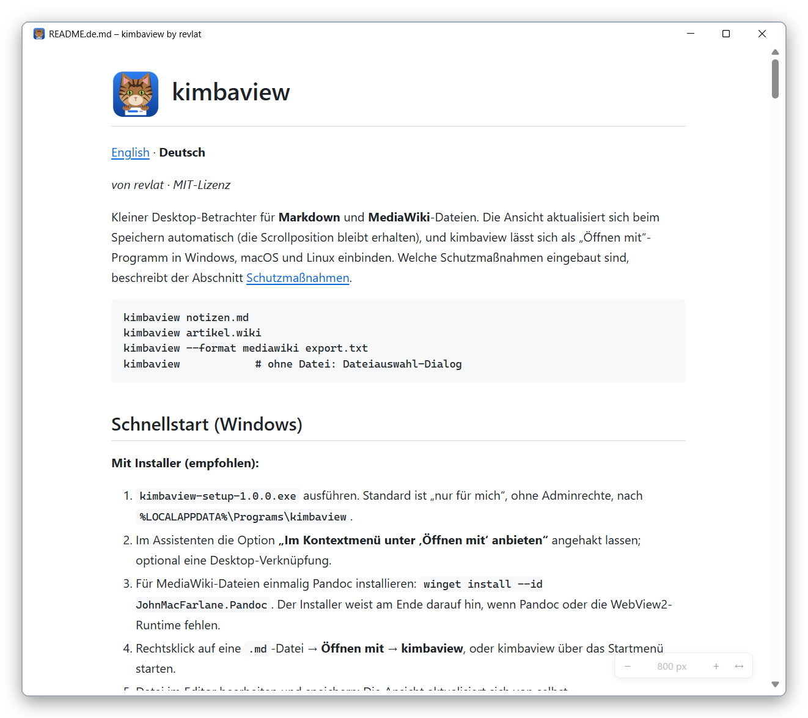

#  kimbaview

🇬🇧 [English](README.md) | 🇩🇪 [Deutsch](README_DE.md)

*von revlat · MIT-Lizenz*

Kleiner Desktop-Betrachter für **Markdown** und **MediaWiki**-Dateien.
Die Ansicht aktualisiert sich beim Speichern automatisch (die Scrollposition bleibt
erhalten), und kimbaview lässt sich als „Öffnen mit“-Programm in Windows, macOS und
Linux einbinden. Welche Schutzmaßnahmen eingebaut sind, beschreibt der Abschnitt
[Schutzmaßnahmen](#schutzmaßnahmen).

```
kimbaview notizen.md
kimbaview artikel.wiki
kimbaview --format mediawiki export.txt
kimbaview            # ohne Datei: Dateiauswahl-Dialog
```

## Screenshot

*So sieht kimbaview aus, hier mit dieser Anleitung geöffnet:*



## Schnellstart (Windows)

**Mit Installer (empfohlen):**

1. `kimbaview-setup-1.0.2.exe` ausführen. Standard ist „nur für mich“, ohne
   Adminrechte, nach `%LOCALAPPDATA%\Programs\kimbaview`.
2. Im Assistenten die Option **„Im Kontextmenü unter ‚Öffnen mit‘ anbieten“**
   angehakt lassen; optional eine Desktop-Verknüpfung.
3. Für MediaWiki-Dateien einmalig Pandoc installieren:
   `winget install --id JohnMacFarlane.Pandoc`. Der Installer weist am Ende darauf
   hin, wenn Pandoc oder die WebView2-Runtime fehlen.
4. Rechtsklick auf eine `.md`-Datei → **Öffnen mit → kimbaview**, oder kimbaview über das
   Startmenü starten.
5. Datei im Editor bearbeiten und speichern: Die Ansicht aktualisiert sich von selbst.

Deinstallieren: *Einstellungen → Apps → Installierte Apps → kimbaview*. Dabei
werden auch die „Öffnen mit“-Einträge entfernt; Einträge anderer Programme bleiben.

**Ohne Installer (portabel):** den ganzen Ordner `kimbaview` (mit `kimbaview.exe`,
`_internal` und den Lizenzdateien) an einen festen Ort kopieren und `kimbaview.exe`
starten bzw. eine Datei darauf ziehen. „Öffnen mit“ dann per Skript einrichten, siehe
[„Öffnen mit“ einrichten](#öffnen-mit-einrichten).

Voraussetzungen auf dem Zielrechner: Windows 10/11 (64 Bit), WebView2-Runtime (in
Windows 11 enthalten), .NET Framework 4.7.2+ (in Windows 10/11 enthalten). Python wird
**nicht** benötigt.

Beim ersten Start kann Windows SmartScreen warnen, weil Installer und Programm nicht
signiert sind (*Weitere Informationen → Trotzdem ausführen*).

## Schnellstart (macOS)

1. `kimbaview-<version>-macos-arm64.dmg` aus den GitHub-Releases laden und öffnen.
2. `kimbaview` auf den Ordner **Programme** ziehen.
3. Für MediaWiki-Dateien: `brew install pandoc` (Markdown geht auch ohne).
4. Rechtsklick auf eine `.md`-Datei im Finder → **Öffnen mit → kimbaview**.

Ist der Build nicht signiert, meldet macOS beim ersten Start, dass die App nicht
geöffnet werden kann. Dann *Systemeinstellungen → Datenschutz & Sicherheit* öffnen,
nach unten scrollen und bei kimbaview auf **„Trotzdem öffnen“** klicken (einmalig).
Der Paketbau umfasst derzeit nur Macs mit Apple-Chip (M1 und neuer).

## Schnellstart (Linux)

Voraussetzung: Python 3.10+ und die Web-Engine des Systems, z. B. ab Ubuntu 22.04,
Debian 12, Fedora 36, Linux Mint 21.

```bash
# 1. Systempakete (einmalig; Fedora/Arch/openSUSE: siehe Meldung von install.sh)
sudo apt install python3-venv python3-gi gir1.2-webkit2-4.1 pandoc

# 2. Paket aus den GitHub-Releases entpacken und installieren (ohne Root-Rechte)
tar xzf kimbaview-<version>-linux.tar.gz
cd kimbaview-<version>-linux
./install.sh
```

Danach steht kimbaview im Startmenü und unter **Öffnen mit**, im Terminal gibt es
`kimbaview datei.md`. Entfernen: `./uninstall.sh` im selben Ordner. `install.sh` prüft
vorher alle Voraussetzungen und nennt bei Bedarf den passenden Installationsbefehl für
Debian/Ubuntu, Fedora, Arch und openSUSE.

Die Pakete für alle drei Systeme baut eine GitHub-Pipeline (`.github/workflows/build.yml`).

---

## Aus dem Quellcode installieren (Entwicklung)

### 1. Python 3.10 oder neuer

| System  | Befehl / Quelle |
|---------|-----------------|
| Windows | `winget install Python.Python.3.12` oder https://www.python.org |
| macOS   | `brew install python@3.12` oder https://www.python.org |
| Linux   | meist vorhanden; sonst `sudo apt install python3 python3-venv` |

### 2. Pandoc (nur für MediaWiki)

Markdown funktioniert ohne Pandoc. Fehlt Pandoc, zeigt kimbaview bei MediaWiki-Dateien
eine Meldung mit Installationshinweis.

| System  | Befehl |
|---------|--------|
| Windows | `winget install --id JohnMacFarlane.Pandoc` |
| macOS   | `brew install pandoc` |
| Linux   | `sudo apt install pandoc` · `sudo dnf install pandoc` · `sudo pacman -S pandoc` |

kimbaview sucht Pandoc im `PATH` und zusätzlich an den üblichen Orten
(`%LOCALAPPDATA%\Pandoc`, `C:\Program Files\Pandoc`, `/opt/homebrew/bin`, `/usr/local/bin`,
`/usr/bin`, `~/.local/bin`). Das ist nötig, weil per Doppelklick gestartete Programme
oft einen verkürzten `PATH` haben.
Empfohlen ist Pandoc **2.15 oder neuer**, weil kimbaview dann `--sandbox` nutzt.

### 3. kimbaview

```bash
git clone … kimbaview && cd kimbaview      # oder Ordner entpacken
python -m venv .venv
# Windows:  .venv\Scripts\activate      macOS/Linux:  source .venv/bin/activate
pip install -e .
pip install -e ".[dev]"                  # zusätzlich pytest für die Tests
```

Danach gibt es den Befehl `kimbaview`. Unter Windows ist das ein GUI-Programm
(`.venv\Scripts\kimbaview.exe`) und öffnet **kein Konsolenfenster**.

**Linux:** pywebview nutzt die Web-Engine des Systems (WebKitGTK). Die Python-Anbindung
dazu (`gi`) kommt am zuverlässigsten aus den Systempaketen, deshalb die venv mit
`--system-site-packages` anlegen:

```bash
sudo apt install python3-venv python3-gi gir1.2-webkit2-4.1
python3 -m venv --system-site-packages .venv && . .venv/bin/activate
pip install -e ".[dev]"
```

(`pip install "pywebview[gtk]"` würde PyGObject aus dem Quellcode kompilieren und
scheitert ohne Entwicklerpakete oft. Alternativ geht Qt: `pip install -e ".[qt]"`.)

**Windows:** benötigt die Microsoft-Edge-WebView2-Runtime. Sie ist unter Windows 11
vorinstalliert.

---

## Nutzung

* `kimbaview <datei>` öffnet die Datei in einem eigenen Fenster. Mehrere Dateien
  (`kimbaview a.md b.wiki`) bekommen jeweils ein eigenes Fenster mit eigener
  Überwachung. Beim „Öffnen mit“ startet ohnehin pro Datei ein eigener Prozess.
* Ohne Datei erscheint ein Dateiauswahl-Dialog; bei *Abbrechen* schließt sich das Fenster.
* **Formaterkennung** über die Endung:
  Markdown: `.md`, `.markdown`; MediaWiki: `.mediawiki`, `.wiki`, `.wikitext`.
  `--format md|mediawiki` überschreibt die Erkennung.
* Der Fenstertitel zeigt den Dateinamen.
* **Live-Aktualisierung:** Beim Speichern wird neu gerendert (entprellt, ca. 200 ms),
  die Scrollposition bleibt erhalten. Wird die Datei gelöscht oder umbenannt, erscheint
  ein Hinweis und der letzte Stand bleibt sichtbar. Taucht sie wieder auf, wird sie neu
  geladen.
* **Fehler** (z. B. halbfertige Syntax, Pandoc-Fehler, zu große Datei) erscheinen als
  Hinweisleiste oben. Der letzte funktionierende Stand bleibt sichtbar.
* **Links**
  * `http(s)` öffnet sich im Standardbrowser. Die Zieladresse steht im Tooltip.
  * `#abschnitt` springt innerhalb des Dokuments.
  * **Links auf andere Markdown-/MediaWiki-Dateien** (`kapitel2.md`,
    `unterordner/seite.md`, `../index.md`, `andere.md#abschnitt`) öffnen die Datei
    **im selben Fenster**. **Strg+Klick** oder **Mittelklick** öffnet sie in einem
    **neuen Fenster**.
  * **Zurück/Vor:** die Pfeile `‹ ›` unten rechts, **Alt+← / Alt+→** oder die
    Seitentasten der Maus. Die Scrollposition jeder Seite bleibt dabei erhalten.
  * MediaWiki-Links ohne Endung (`[[Seite]]`) suchen `Seite.wiki`, `Seite.mediawiki`
    usw. im selben Ordner (Unterstriche werden auch als Leerzeichen probiert).
  * **Grenze:** Erreichbar sind nur Dateien im Ordner der zuerst geöffneten Datei
    und dessen Unterordnern. Innerhalb davon gehen auch Links nach oben (`../`). Ziele
    außerhalb, fehlende Dateien und andere Dateitypen (`.pdf`, `.exe`, Bilder …) werden
    nicht geöffnet, unten links erscheint dann ein kurzer Hinweis.
  * `mailto:`, `file:` und andere Schemata werden ignoriert.
* **Textbreite:** Die kleine Leiste unten rechts (wird beim Überfahren deutlich)
  stellt die Breite in Stufen ein: 600, 700, 800, 900, 1000, 1200, 1400 px oder volle
  Fensterbreite. Tastenkürzel: **Strg+Umschalt+←/→** schmaler/breiter,
  **Strg+Umschalt+F** volle Breite ein/aus. Die zuletzt gewählte Breite gilt beim
  nächsten Start wieder. Gespeichert wird sie in `%APPDATA%\kimbaview\settings.json`
  (macOS: `~/Library/Application Support/kimbaview/`, Linux: `~/.config/kimbaview/`).
* **Sprache:** Die Oberfläche ist auf Deutsch, wenn die Systemsprache Deutsch ist, sonst auf
  Englisch. Umschalten mit `--lang de` bzw. `--lang en` oder der Umgebungsvariablen
  `KIMBAVIEW_LANG`. Der Installer wählt seine Sprache ebenfalls nach der Windows-Sprache.
* Strg + Mausrad / Strg + `+`/`-` zoomt.
* `--debug` schreibt Protokollmeldungen nach stderr (nur sichtbar, wenn aus einem
  Terminal mit `python -m kimbaview --debug …` gestartet).

### Beispieldateien

| Datei | Inhalt |
|-------|--------|
| `examples/example.md` | Überschriften, Listen, Task-Liste, Tabelle mit Ausrichtung, Code, lokales Bild, Fußnote, Links auf andere Dateien |
| `examples/unterordner/seite.md` | Links zurück (`../example.md`, mit Anker), auf MediaWiki und auf ein fehlendes Ziel; Bild aus dem Elternordner |
| `examples/example.mediawiki` | dasselbe in MediaWiki inkl. Vorlagen (`{{Infobox Software}}`, `{{Datum}}`) |
| `examples/evil.md` | typische Angriffe (Skripte, Event-Handler, `javascript:`-Links, externe Bilder, Pfade nach außen, Formulare, DOM-Clobbering). Dient zum Testen der Schutzmaßnahmen; die Angriffe sollen entschärft angezeigt werden. |

---

## „Öffnen mit“ einrichten

### Windows (vollständig umgesetzt und getestet)

**Installer bauen** (empfohlen für die Weitergabe). Voraussetzung ist Inno Setup 6:
`winget install JRSoftware.InnoSetup`.

```powershell
pip install -e ".[build]"
powershell -ExecutionPolicy Bypass -File packaging\windows\build-installer.ps1
```

Ergebnis: `dist\installer\kimbaview-setup-<version>.exe`. Er enthält Programm, Lizenzen,
Startmenü-Eintrag, die optionale „Öffnen mit“-Registrierung (dieselben Einträge wie das
Skript unten) und einen Deinstaller. Die Konfiguration steht in
`packaging\windows\kimbaview.iss`.

**Alternativ ohne Installer:**

1. **Programm bauen** (PyInstaller, Ordner-Build ohne Konsolenfenster):

   ```powershell
   pip install -e ".[build]"
   powershell -ExecutionPolicy Bypass -File packaging\windows\build.ps1
   ```

   Ergebnis: `dist\kimbaview\kimbaview.exe` (den ganzen Ordner `dist\kimbaview` behalten).
   Am besten an einen festen Ort kopieren, z. B. `%LOCALAPPDATA%\Programs\kimbaview`.

2. **Registrieren** (nur aktueller Benutzer, **keine Adminrechte**):

   ```powershell
   powershell -ExecutionPolicy Bypass -File packaging\windows\register-openwith.ps1
   # anderer Ort der exe:
   powershell -ExecutionPolicy Bypass -File packaging\windows\register-openwith.ps1 -ExePath "C:\…\kimbaview.exe"
   # nur anzeigen, was passieren würde:
   powershell -ExecutionPolicy Bypass -File packaging\windows\register-openwith.ps1 -WhatIf
   ```

   Danach erscheint kimbaview für `.md`, `.markdown`, `.mediawiki` und `.wiki` im
   Kontextmenü unter **Öffnen mit**. Das Standardprogramm wird nicht verändert. Wer
   kimbaview als Standard möchte: *Öffnen mit → Andere App auswählen → kimbaview →
   Immer*.

   Ohne PyInstaller-Build geht auch die pip-Installation:
   `-ExePath .venv\Scripts\kimbaview.exe`.

3. **Entfernen:**

   ```powershell
   powershell -ExecutionPolicy Bypass -File packaging\windows\unregister-openwith.ps1
   ```

   Das Skript entfernt nur die Einträge von kimbaview (`HKCU\Software\Classes\kimbaview.Document`,
   `…\Applications\kimbaview.exe` und den Wert `kimbaview.Document` unter
   `…\.<endung>\OpenWithProgids`). Einträge anderer Programme bleiben unberührt.

### macOS (py2app)

Fertige DMG-Pakete baut die GitHub-Pipeline. Selbst
bauen auf einem Mac im Projektordner:

```bash
python3 -m venv .venv && source .venv/bin/activate
pip install . py2app                 # ohne -e: py2app findet editierbare Installationen schlecht
sh packaging/macos/build-dmg.sh      # → dist/kimbaview.app und dist/kimbaview-<v>-macos-<arch>.dmg
cp -R dist/kimbaview.app ~/Applications/        # oder die DMG öffnen und hineinziehen
```

Die `Info.plist` trägt die Dateitypen ein (`CFBundleDocumentTypes` für
`net.daringfireball.markdown` und `org.mediawiki.wikitext` mit den Endungen
`md, markdown, mediawiki, wiki, wikitext`, Rolle *Viewer*, Rang *Alternate*). Danach
erscheint kimbaview im Finder unter **Öffnen mit**. Falls nicht sofort: App einmal
starten oder abmelden und wieder anmelden.

Hinweise:
* Ohne Developer-ID-Signatur blockiert macOS den ersten Start. Freigabe unter
  *Systemeinstellungen → Datenschutz & Sicherheit → „Trotzdem öffnen“*. Signieren und
  Notarisieren übernimmt die Pipeline automatisch, sobald die passenden Secrets
  im Repository hinterlegt sind.
* macOS übergibt Dateien per Apple-Event. py2app wandelt das beim **Start** in
  `sys.argv` um (`argv_emulation`). Läuft kimbaview schon, startet ein weiteres
  „Öffnen mit“ keine zweite Instanz. Dann kimbaview schließen und erneut öffnen oder
  `open -n -a kimbaview datei.md` verwenden.
* Pandoc aus Homebrew wird auch ohne `PATH` gefunden (`/opt/homebrew/bin`, `/usr/local/bin`).

### Linux (.desktop-Datei)

Mit dem fertigen Paket erledigt `./install.sh` alles (siehe Schnellstart). Bei einer
Installation aus dem Quellcode:

```bash
# venv wie oben unter „Aus dem Quellcode installieren“ anlegen, dann:
sh packaging/linux/install.sh      # registrieren (aktueller Benutzer)
sh packaging/linux/uninstall.sh    # entfernen
```

`install.sh` kopiert `kimbaview.desktop` (`Exec=kimbaview %f`) nach
`~/.local/share/applications` und den eigenen MIME-Typ **`text/x-mediawiki`**
(`*.mediawiki`, `*.wiki`, `*.wikitext`) nach `~/.local/share/mime/packages`. Danach ruft
es `update-mime-database` und `update-desktop-database` auf. Markdown nutzt den
Standardtyp `text/markdown`.
Ist `kimbaview` im `PATH` zu finden, setzt das Skript den absoluten Pfad in `Exec=` ein,
weil Startmenüs `~/.local/bin` oder eine venv sonst oft nicht kennen.
Als Standard festlegen (optional):
`xdg-mime default kimbaview.desktop text/markdown text/x-mediawiki`.

---

## Schutzmaßnahmen

Dieser Abschnitt beschreibt, welche Vorkehrungen kimbaview beim Anzeigen von Dateien trifft.
Er ist **keine Zusicherung**: Software kann Fehler enthalten, und es gibt keine
Gewährleistung (siehe [Lizenz und Haftung](#lizenz-und-haftung)). Öffne Dateien aus
unbekannten Quellen mit der gleichen Vorsicht wie bei anderen Programmen.

| Ebene | Maßnahme |
|-------|----------|
| **Bereinigung** | Das HTML **beider** Formate läuft durch **nh3** (ammonia) mit Allowlist: Formatierung, Überschriften, Listen, Tabellen, Code, Bilder, Links. `script`, `style`, `iframe`, `object`, `embed`, `svg`, `math`, `template` u. a. werden **samt Inhalt** entfernt, `form`, `input` (außer Task-Checkboxen), `link`, `meta`, `base` ohne Ersatz. Keine `on*`-Attribute. `href`/`src` nur `http`/`https` oder relativ; `javascript:`, `data:`, `file:`, `vbscript:`, protokoll-relative `//host`-URLs und verschleierte Schemata (`jav%09ascript:`) fliegen raus. CSS-Klassen nur aus einer festen Liste. `style` nur `text-align` in Tabellenzellen, das in eine Klasse umgewandelt wird. |
| **DOM-Clobbering** | Alle `id`s aus Dokumenten bekommen das Präfix `wv-u-`; `name` ist nicht erlaubt. Dokumente können so keine Elemente oder Globals der Oberfläche überdecken. |
| **Content-Security-Policy** | `default-src 'none'`; Skript und Styles **nur per Nonce** (ein eigenes Skript, ein eigenes Stylesheet); `img-src data:`; `connect-src`, `font-src`, `frame-src`, `object-src`, `form-action`, `base-uri` = `'none'`. Kein `unsafe-inline`, kein `unsafe-eval`. Im echten WebView geprüft: Nachträglich eingefügte Inline-Skripte und externe Bilder werden blockiert. |
| **Keine externen Ressourcen** | CSS und Skript sind lokal im Paket. Schriften sind Systemschriften (nichts wird geladen). Die Syntaxhervorhebung macht **Pygments in Python**, also ohne JavaScript-Bibliothek im Fenster. Externe Bilder werden **nicht** geladen, sondern als Platzhalter mit ihrer Adresse gezeigt. |
| **Lokale Dokument-Links** | Nur Dateien mit Dokument-Endung (`.md`, `.markdown`, `.mediawiki`, `.wiki`, `.wikitext`), niemals Programme oder andere Dateitypen. Das Ziel muss nach vollständiger Auflösung (inkl. Symlinks/Junctions) im *Wurzelordner* liegen, also im Ordner der Datei, die du selbst geöffnet hast (Kommandozeile, „Öffnen mit“, Dialog). Geöffnete Dateien werden genauso bereinigt wie jede andere. Die Anfrage kommt als Datenwert über `pywebview.state` und wird in Python nach Typ, Länge und erlaubten Werten geprüft. |
| **Lokale Bilder** | Nur aus dem Wurzelordner (Ordner der zuerst geöffneten Datei) und dessen Unterordnern; relative Pfade gelten ab dem gerade angezeigten Dokument. Der Pfad wird vollständig aufgelöst (`..`, URL-Kodierung, Symlinks, Windows-Junctions). Abgelehnt werden alles außerhalb, absolute Pfade, Laufwerksbuchstaben, UNC-Pfade und NTFS-Streams (`a.png:x`). Erlaubte Bilder werden als `data:`-URI eingebettet (max. 10 MB pro Bild, 40 MB pro Dokument; nur Bildendungen). Das Fenster selbst hat keinen Dateizugriff (`ALLOW_FILE_URLS = False`). |
| **Links** | Nie im Reader-Fenster. Ein eigenes Skript fängt Klicks (auch Mittelklick) ab: `#anker` scrollt, `http(s)` geht an pywebviews „neues Fenster“ → Standardbrowser, alles andere wird verworfen. Zusätzlich ist `webbrowser.open` in Python prozessweit durch eine Prüfung ersetzt, die nur `http`/`https` mit Hostnamen durchlässt, als zweite Prüfung unabhängig vom Skript. Drag & Drop von Dateien ins Fenster ist blockiert (würde sonst ungeprüft navigieren). |
| **Keine JS-API-Brücke** | `js_api` wird **nicht** verwendet. JavaScript kann keine Python-Funktion aufrufen. Python schiebt Inhalte nur per `run_js` als JSON-Literal ins Fenster. Rückmeldungen vom Fenster gibt es nur als Datenwerte über pywebviews `state`-Objekt: die gewählte Textbreite (nur Werte aus der festen Liste der Breitenstufen) und Navigationswünsche (öffnen/zurück/vor, siehe oben). Beides wird in Python streng geprüft. |
| **Kein Server, kein Port** | Die Seite wird direkt geladen (`html=`), Inhalte per `run_js`. Es wird kein Netzwerkport geöffnet. |
| **Pandoc** | Nur `subprocess.run([...], shell=False)`, Eingabe über stdin, Ausgabe über stdout, **Zeitlimit 10 s**. Argumente: `--sandbox --from=mediawiki --to=html5 --wrap=none --syntax-highlighting=none`. Keine Filter, kein Lua, kein `--standalone`, keine Templates, kein Nachladen. Kein Konsolenfenster unter Windows. |
| **Dateien** | Über **20 MB** wird mit Hinweis abgelehnt (vor *und* während des Lesens geprüft). Ungültiges UTF-8 wird mit Ersatzzeichen gelesen. Fehler beim Lesen und Rendern werden als Hinweis angezeigt, statt das Programm zu beenden. |
| **Privatsphäre** | Keine Telemetrie, keine Update-Prüfung, keine Netzwerkzugriffe. Einzige Ausnahme: Ein Klick auf einen http(s)-Link öffnet den Standardbrowser. Das WebView läuft im Privatmodus (keine Cookies/Cache auf der Platte). |

### Restrisiken

* **Web-Engine des Systems:** Der Schutz hängt auch von WebView2, WKWebView bzw.
  WebKitGTK ab. Diese sollten aktuell sein (Windows Update, macOS-Updates,
  Paketmanager).
* **pywebview-Interna:** pywebview injiziert eigenes JavaScript mit einer internen
  Nachrichtenschnittstelle, auch ohne `js_api`. Erreichbar wäre sie nur, wenn
  Sanitizer **und** CSP gleichzeitig versagten.
* **TOCTOU bei Bildern:** Zwischen Pfadprüfung und Lesen könnte ein Angreifer mit
  Schreibrechten im Dokumentordner einen Symlink austauschen. Wer dort schreiben kann,
  könnte aber ohnehin die Datei selbst ändern.
* **Pandoc ohne `--sandbox`:** Bei Pandoc < 2.15 fehlt die zusätzliche Sandbox. Der
  MediaWiki-Reader lädt auch dann keine Dateien nach, trotzdem lieber aktualisieren.
* **Rechenzeit:** Sehr große, pathologische Dokumente können das Rendern verlangsamen.
  Begrenzt wird das durch das 20-MB-Limit, das Pandoc-Zeitlimit und keine
  Hervorhebung bei Codeblöcken über 200 000 Zeichen.
* **Externe Links:** Ein Klick öffnet die echte Adresse im Browser. Phishing-Links
  erkennt kimbaview nicht. Die Zieladresse erscheint als Tooltip, wenn die Maus über
  dem Link verweilt. Vor dem Klick lohnt sich ein Blick darauf.
* **Unsignierte Builds:** `.exe`/`.app` sind nicht signiert. SmartScreen bzw.
  Gatekeeper warnen beim ersten Start.

---

## Entscheidungen

* **Python + pywebview** statt Go/Wails: Für alle Vorgaben (markdown-it-py, nh3,
  watchdog, Pygments, PyInstaller, py2app) gibt es ausgereifte Bibliotheken. pywebview
  nutzt auf allen drei Systemen die eingebaute Web-Engine.
* **Inhalte per `run_js`, Bilder als `data:`-URIs:** Damit braucht das Fenster weder
  einen lokalen Server noch Dateizugriff.
* **Keine JS-Brücke:** Externe Links laufen über pywebviews eingebaute
  „Neues Fenster → Browser“-Behandlung plus Python-seitig geprüftes `webbrowser.open`.
* **Pygments statt highlight.js:** Die Hervorhebung passiert vor der Bereinigung in
  Python, im Fenster läuft dafür kein zusätzliches Skript. Pandoc-eigene Hervorhebung
  ist abgeschaltet, damit beide Formate gleich aussehen.
* **Rohes HTML in Markdown ist erlaubt** (z. B. `<details>`, `<kbd>`, `<sup>`), wird aber
  immer bereinigt. `<script>` wird dabei samt Inhalt entfernt.
* **Vorlagen in MediaWiki:** Pandoc verwirft `{{…}}` stillschweigend. kimbaview ersetzt
  Vorlagen vorher durch Marker und zeigt danach einen gestrichelt umrandeten
  Platzhalter `{{Name}}`. Verschachtelte Vorlagen zählen als eine. In `<nowiki>`,
  `<pre>`, `<syntaxhighlight>`, `<source>`, `<math>` und Kommentaren bleibt `{{…}}`
  unverändert (wie in MediaWiki). In `<code>` wertet MediaWiki Vorlagen aus, dort
  erscheint deshalb ebenfalls ein Platzhalter.
* **Unbekannte Endung** (z. B. `.txt` über „Öffnen mit“): wird als Markdown angezeigt.
* **Wurzelordner für Links und Bilder:** Grenze ist der Ordner der Datei, die du
  ausdrücklich geöffnet hast, nicht der Ordner der gerade angezeigten Datei. So
  funktionieren Links in Unterordner *und* wieder zurück (`../index.md`), ohne dass
  ein Dokument Zugriff auf Ordner darüber bekommt. Wer eine ganze Dokumentation
  durchklicken will, öffnet am besten die oberste Datei (z. B. `index.md`).
* **Interne Wiki-Links** (`[[Seite]]`) zeigen auf eine Datei gleichen Namens im
  selben Ordner, falls vorhanden. Ein echtes Wiki gibt es ja nicht.
* **Watchdog-Timeout 0,1 s:** watchdog bündelt Ereignisse standardmäßig eine Sekunde
  lang. Mit dem kürzeren Timeout erscheint eine gespeicherte Änderung nach etwa 0,3 bis
  0,4 s statt nach 1,2 s.
* **`.wikitext`** wird erkannt, aber von den Windows-Skripten nicht registriert
  (Vorgabe: `.md`, `.markdown`, `.mediawiki`, `.wiki`). Bei Bedarf in `$extensions`
  ergänzen.
* **PyInstaller als Ordner-Build** (`--onedir`): startet schneller als `--onefile` und
  löst seltener Fehlalarme bei Virenscannern aus.
* **Überwacht wird das Verzeichnis**, nicht die Datei (atomares Speichern). Ist die
  geöffnete Datei ein Symlink, werden Änderungen am Link-Namen erkannt, nicht an einem
  Ziel in einem anderen Ordner.

---

## Tests

```bash
pip install -e ".[dev]"
pytest
```

Alle Tests laufen **ohne Grafikdisplay**:

* `test_formats.py`: Erkennung per Endung und `--format`
* `test_render.py`: beide Formate (Überschriften, Listen, Tabellen, Code, Links,
  Fußnoten, Task-Listen, Vorlagen-Platzhalter, lokale Bilder)
* `test_security.py`: `<script>`, Event-Handler, `javascript:`-/`data:`-/`file:`-Links,
  gefährliche Tags, Path Traversal, Symlinks/Junctions nach außen, Dateigröße,
  ungültiges UTF-8, Pandoc-Aufruf (keine Shell, Minimal-Argumente, Zeitlimit,
  fehlendes Pandoc), CSP, `webbrowser`-Absicherung, `evil.md`
* `test_watcher.py`: Änderung, atomares Speichern, Löschen/Wiederherstellen,
  Umbenennen, Entprellung, unabhängige Watcher, Ende-zu-Ende mit Controller
* `test_controller.py`: Fehlerverhalten (letzter Stand bleibt, nie abstürzen)
* `test_navigation.py`: Links zwischen Dokumenten (Unterordner, `../`, Anker,
  Wiki-Links ohne Endung), Ablehnung von Zielen außerhalb, Symlinks/Junctions,
  absoluten Pfaden, anderen Dateitypen; Prüfung der Anfragen aus dem Fenster
* `test_settings.py`: gespeicherte Textbreite, kaputte/manipulierte Einstellungsdatei
* `test_i18n.py`: alle Texte in beiden Sprachen vorhanden, Sprachauswahl, Englisch als Standard

Tests, die echtes Pandoc brauchen, werden ohne Pandoc übersprungen. Der Test für
Datei-Symlinks wird unter Windows ohne Entwicklermodus übersprungen; Verzeichnis-Links
nach außen werden dort per Junction getestet.

## Lizenz und Haftung

kimbaview steht unter der **MIT-Lizenz** (siehe [`LICENSE`](LICENSE)). Die Lizenz
erlaubt Nutzung, Änderung und Weitergabe, auch kommerziell, solange der
Lizenztext beiliegt. Sie schließt Gewährleistung und Haftung aus:

> Die Software wird „wie besehen“ bereitgestellt, ohne jegliche ausdrückliche oder
> stillschweigende Gewährleistung. In keinem Fall haften die Autoren oder
> Rechteinhaber für Ansprüche, Schäden oder sonstige Verpflichtungen, die aus der
> Software, ihrer Nutzung oder dem sonstigen Umgang damit entstehen.
> *(Unverbindliche Übersetzung; maßgeblich ist der englische Text in `LICENSE`.)*

**Hinweis zum deutschen Recht (keine Rechtsberatung):** Ein vollständiger
Haftungsausschluss ist in Deutschland nicht in jedem Fall wirksam. Für Vorsatz und
grobe Fahrlässigkeit sowie nach dem Produkthaftungsgesetz kann die Haftung nicht
ausgeschlossen werden. Bei unentgeltlich überlassener Software ist die Haftung
allerdings ohnehin weitgehend auf Vorsatz und grobe Fahrlässigkeit beschränkt
(§§ 521, 524 BGB). Wer kimbaview gewerblich oder gegen Entgelt weitergibt, sollte das
rechtlich prüfen lassen.

**Fremdkomponenten:** Die gebauten Programme enthalten Python und mehrere
Bibliotheken unter freizügigen Lizenzen: pywebview, Pygments, pycparser (BSD);
markdown-it-py, mdit-py-plugins, mdurl, nh3, pythonnet, clr-loader, bottle,
proxy-tools, cffi (MIT bzw. MIT-0); unter macOS zusätzlich PyObjC (MIT); watchdog
(Apache-2.0); Python, typing-extensions (PSF); unter Windows die mit pywebview
gelieferten Bibliotheken des Microsoft WebView2 SDK (BSD-artige Lizenz von Microsoft).
Die Build-Skripte erzeugen automatisch `THIRD-PARTY-LICENSES.txt` mit allen
Lizenztexten und legen sie zusammen mit `LICENSE.txt` neben die `.exe` bzw. in
`kimbaview.app/Contents/Resources`. Bei Weitergabe diese Dateien immer mitliefern.
Pandoc (GPL) wird **nicht** mitgeliefert, sondern nur als separates Programm
aufgerufen.

Rechteinhaber: **revlat** (Copyright © 2026 revlat). So steht es in `LICENSE`, im
Installer und in den Dateieigenschaften der `.exe`.

## Programm-Icon

Das Icon zeigt **Kimba**, eine getigerte Katze, die über ein Dokument schaut. Es wird
per Skript aus `packaging/icon/` erzeugt und
liegt fertig im Projekt (`src/kimbaview/assets/kimbaview.ico|png`,
`packaging/macos/kimbaview.icns`, `packaging/linux/kimbaview.png`). Neu erzeugen nach
Änderungen am Motiv:

```bash
pip install pillow
python packaging/make_icons.py
```

Die Build-Skripte binden es automatisch ein: in die .exe, den Installer, die
Startmenü-Verknüpfung, die macOS-App und die Linux-.desktop-Datei.

## Projektstruktur

```
src/kimbaview/
  app.py               Kommandozeile, Fenster (pywebview)
  controller.py        Laden/Rendern/Fehlerlogik pro Dokument (ohne GUI testbar)
  watcher.py           watchdog-Überwachung des Verzeichnisses, Entprellung
  formats.py           Formaterkennung
  loader.py            größenbegrenztes, tolerantes Lesen
  render.py            Pipeline: Renderer → Sanitizer → Bilder
  render_markdown.py   markdown-it-py + Plugins
  render_mediawiki.py  Pandoc-Aufruf, Vorlagen-Platzhalter
  sanitize.py          nh3-Allowlist
  images.py            externe Bilder → Platzhalter, lokale → data:-URI
  paths.py             sichere Pfadauflösung
  links.py             URL-Prüfung, abgesichertes webbrowser.open
  highlight.py         Pygments
  page.py              HTML-Hülle mit CSP/Nonce und Breitenleiste
  settings.py          gespeicherte Einstellungen (Textbreite)
  navigation.py        Links zwischen lokalen Dokumenten (Auflösung + Prüfung)
  i18n.py              Texte der Oberfläche auf Englisch und Deutsch
  assets/style.css, assets/viewer.js, assets/kimbaview.ico|png
packaging/             Windows (PyInstaller, Registry), macOS (py2app), Linux (.desktop),
                       icon/ (Zeichenskripte für das Programm-Icon)
examples/              example.md, example.mediawiki, evil.md, bilder/
docs/                  Bilder der Anleitung (Icon, Screenshots)
tests/
```
